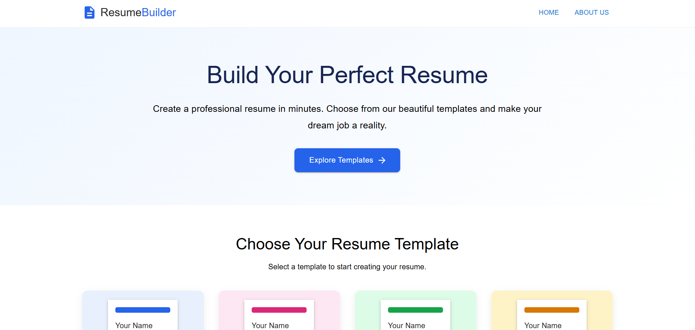
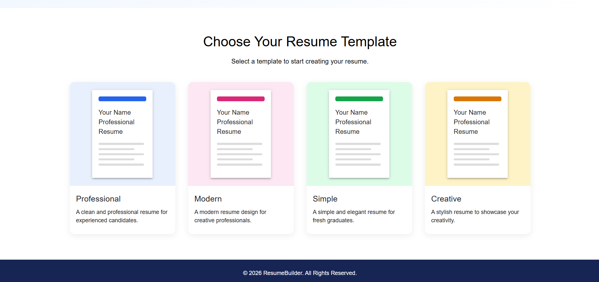
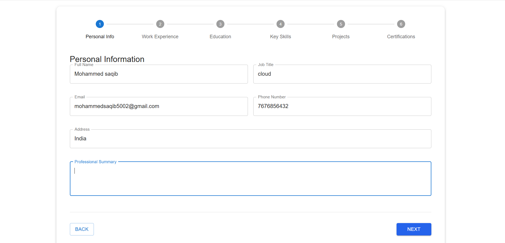
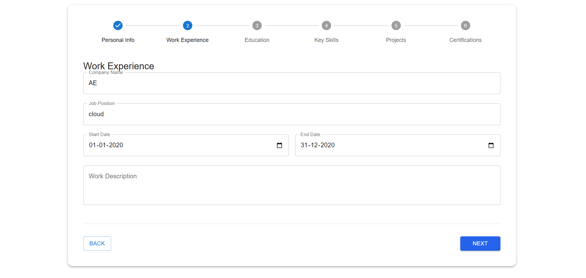
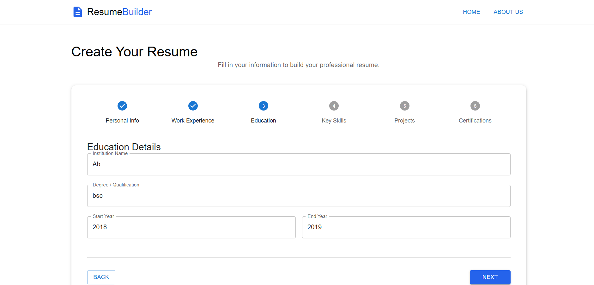
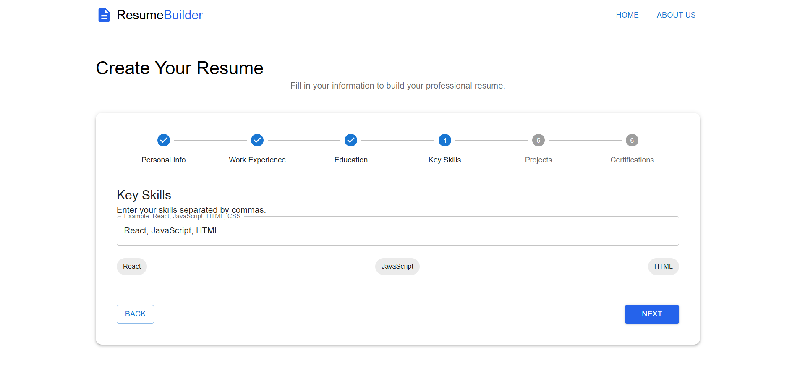
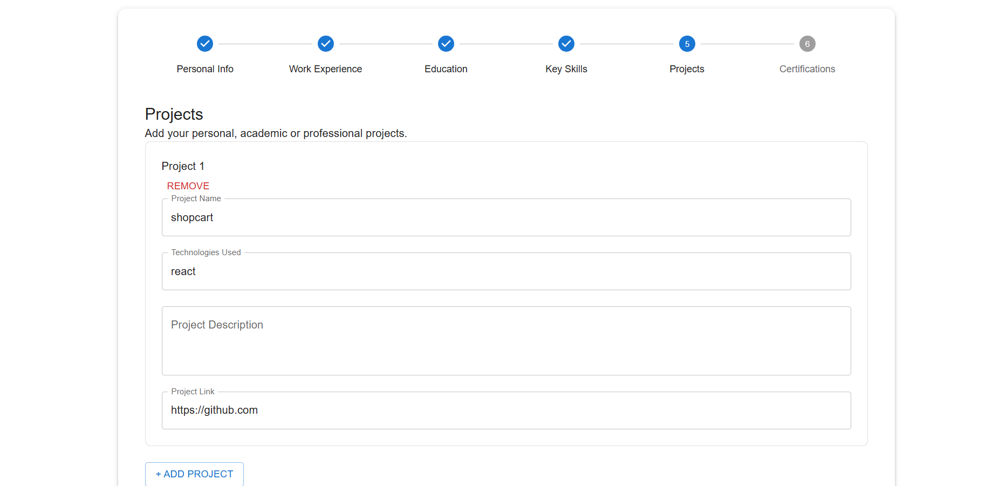
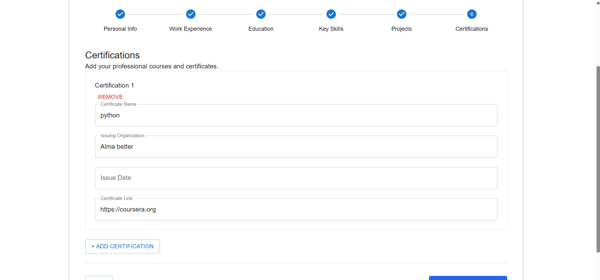
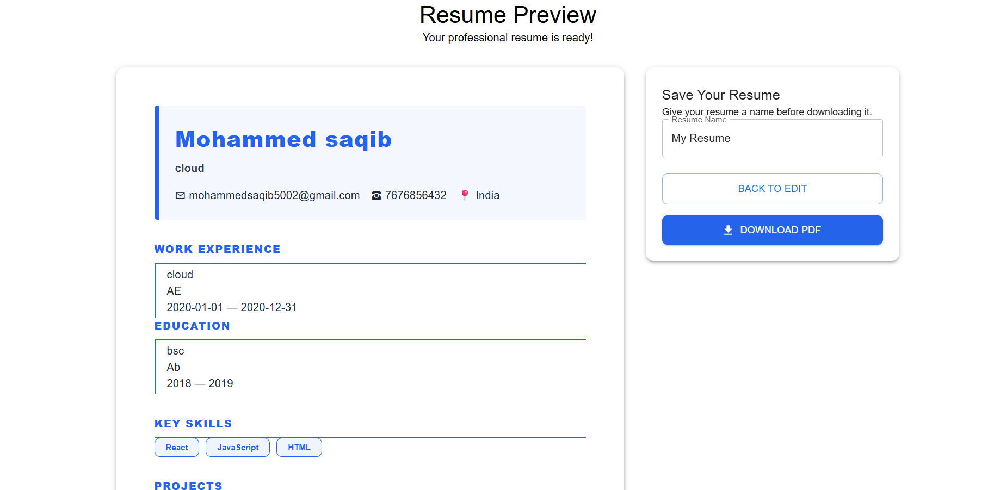

# Resume Builder

<p align="center">
  <strong>Create, customize, preview, and download professional resumes.</strong>
</p>

<p align="center">
  A responsive React application that simplifies resume creation through a guided multi-step form, reusable templates, real-time preview, and PDF export.
</p>

<p align="center">
  <a href="https://resume-builder-a63c4djyn-mohammedsaqib5002-1985s-projects.vercel.app/">Live Demo</a> •
  <a href="https://github.com/mohammedsaqib5002-tech/resume-builder">GitHub Repository</a>
</p>

<p align="center">
  
  
  
  
  
</p>

---

## Overview

Resume Builder is a frontend web application that helps users create professional resumes without manually designing and formatting documents.

Users can enter their personal information, employment history, education, skills, projects, and certifications through a guided workflow. They can choose a resume template, preview the result, return to edit their information, and download their resume as a PDF.

The project focuses on reusable React components, organized application architecture, form validation, centralized state management, responsive design, and automated testing.

## Problem Statement

Creating a professional resume from scratch can be time-consuming and challenging. Users may struggle with:

- Structuring information effectively.
- Maintaining consistent formatting.
- Choosing an appropriate professional layout.
- Organizing career information into clear sections.
- Creating a resume that is ready to share or submit.

## Solution

Resume Builder provides a structured workflow that simplifies resume creation.

- Guided multi-step resume form.
- Reusable form and UI components.
- Resume template selection.
- Input validation and error feedback.
- Centralized resume data management.
- Preview before downloading.
- PDF export.
- Responsive interface for different screen sizes.

## Features

### Resume Creation

- Personal information and professional summary.
- Work experience.
- Education.
- Key skills.
- Projects with technologies and links.
- Certifications with issuing organizations and links.

### Templates and Preview

- Multiple resume templates.
- Template selection.
- Structured resume layout.
- Preview before export.
- Return to editing when changes are needed.

### Dynamic Form Management

- Add and remove projects.
- Add and remove certifications.
- Field-level validation.
- Required-field checks.
- URL validation for projects and certifications.
- Step-based validation before proceeding.

### PDF Export

- Generate downloadable resume documents.
- Capture rendered resume content.
- Export using `jsPDF` and `html2canvas`.
- Download completion feedback.
- Support for longer resume content across multiple PDF pages.

### Responsive UI

- Responsive layouts using Material UI.
- Desktop, tablet, and mobile-friendly structure.
- Adaptable spacing and component layouts.

---

## Application Workflow

| Step | Stage | Description |
|---|---|---|
| 01 | Home | Introduction and resume template selection |
| 02 | Personal Info | Contact details and professional summary |
| 03 | Work Experience | Employment history and responsibilities |
| 04 | Education | Academic qualifications |
| 05 | Key Skills | Professional and technical skills |
| 06 | Projects | Projects, technologies, descriptions, and URLs |
| 07 | Certifications | Credentials, issuing organizations, dates, and URLs |
| 08 | Preview | Review the completed resume |
| 09 | Export | Download the resume as a PDF |

---

## Screenshots

## Screenshots

### Home Page


### Resume Templates


### Personal Information


### Work Experience


### Education


### Key Skills


### Projects


### Certifications


### Resume Preview


> Screenshots and demo video documentation are planned additions.

---

## Tech Stack

| Technology | Purpose |
|---|---|
| React | Component-based UI development |
| JavaScript | Application logic |
| Vite | Development server and production build |
| Material UI (MUI) | UI components and responsive styling |
| Redux Toolkit | Centralized resume state |
| React Redux | Connecting components to Redux |
| React Hook Form | Form management and validation |
| React Router | Application routing |
| jsPDF | PDF generation |
| html2canvas | Capturing rendered resume content |
| Vitest | Automated testing |
| React Testing Library | Component and interaction testing |
| jsdom | Browser-like testing environment |

---

## Project Architecture

The application uses a modular component-based architecture to separate pages, reusable components, form steps, data configuration, state management, and PDF generation.

### Folder Structure

```text
resume-builder/
├── public/
├── src/
│   ├── Components/
│   │   ├── Header.jsx
│   │   ├── TemplateCard.jsx
│   │   ├── FormField.jsx
│   │   ├── PersonalInfoStep.jsx
│   │   ├── WorkExperienceStep.jsx
│   │   ├── EducationStep.jsx
│   │   ├── SkillsStep.jsx
│   │   ├── ProjectsStep.jsx
│   │   ├── CertificationsStep.jsx
│   │   ├── StepNavigation.jsx
│   │   ├── DownloadSuccessDialog.jsx
│   │   ├── ResumeHeader.jsx
│   │   ├── ProfessionalSummary.jsx
│   │   ├── WorkExperiencePreview.jsx
│   │   ├── EducationPreview.jsx
│   │   ├── KeySkillsPreview.jsx
│   │   ├── ProjectsPreview.jsx
│   │   ├── CertificationsPreview.jsx
│   │   └── SectionHeading.jsx
│   ├── Data/
│   │   ├── Data.js
│   │   └── DetailsConfig.js
│   ├── Pages/
│   │   ├── Home.jsx
│   │   ├── Details.jsx
│   │   ├── Preview.jsx
│   │   └── About.jsx
│   ├── Redux/
│   │   └── ResumeSlice.js
│   ├── utilis/
│   │   └── generateResumePDF.js
│   ├── test/
│   │   └── setup.js
│   ├── App.jsx
│   └── main.jsx
├── package.json
├── vite.config.js
├── eslint.config.js
└── README.md
```

*This is a simplified representation of the primary project structure. Test files are maintained alongside the components and modules they test.*

### Architecture Responsibilities

| Module | Responsibility |
|---|---|
| Components | Reusable UI elements and form-step components |
| Pages | Application screens and page-level logic |
| Data | Template data and multi-step form configuration |
| Redux | Centralized resume state and update reducers |
| `App.jsx` | Route configuration and application composition |
| `generateResumePDF.js` | PDF export logic |
| Test Setup | Shared test configuration and initialization |

---

## Application Routes

| Route | Page | Purpose |
|---|---|---|
| `/` | Home | Browse and select resume templates |
| `/details/:templateId` | Details | Enter resume information |
| `/preview` | Preview | Review and export the resume |
| `/about` | About | Learn about the application |

---

## Validation and Error Handling

Form validation helps ensure users provide the required information before moving to the next step.

| Validation | Purpose |
|---|---|
| Required fields | Prevents progression with missing required data |
| Email | Validates email input |
| Phone | Validates phone input |
| Date fields | Checks date requirements and date order |
| Education years | Validates year values and chronological order |
| Skills | Requires at least one valid skill |
| Projects | Validates project names and required project links |
| Project URLs | Checks URL format |
| Certifications | Validates certification information and required links |
| Certification URLs | Checks URL format |

Validation errors are displayed within the form to help users identify and correct invalid entries.

---

## Testing

Automated testing is implemented using **Vitest** and **React Testing Library**.

### Latest Recorded Test Results

| Metric | Result |
|---|---:|
| Test Files | 6 |
| Total Tests | 22 |
| Passing Tests | 22 |
| Failed Tests | 0 |
| Status | Passed |

The test suite covers page rendering, form components, education fields, key skills, Redux state management, and resume form interactions.

### Run Tests

```bash
npm test
```

### Testing Tools

- Vitest
- React Testing Library
- jest-dom
- jsdom

---

## Getting Started

Follow these steps to run the project locally.

### Prerequisites

- [Node.js](https://nodejs.org/)
- npm
- Git

### 1. Clone the repository

```bash
git clone https://github.com/mohammedsaqib5002-tech/resume-builder.git
```

### 2. Navigate to the project directory

```bash
cd resume-builder
```

### 3. Install dependencies

```bash
npm install
```

### 4. Start the development server

```bash
npm run dev
```

### 5. Open the application

Visit the local URL displayed in your terminal, usually:

```text
http://localhost:5173
```

---

## Available Scripts

| Command | Description |
|---|---|
| `npm run dev` | Starts the local development server |
| `npm test` | Runs the Vitest test suite |
| `npm run build` | Creates an optimized production build |
| `npm run preview` | Previews the production build locally |

---

## Production Build

Build the application for production:

```bash
npm run build
```

Vite generates the production assets inside the `dist/` directory.

Preview the production build locally:

```bash
npm run preview
```

---

## Deployment

The application is deployed using **Vercel**.

### Live Application

[Open Resume Builder](https://resume-builder-a63c4djyn-mohammedsaqib5002-1985s-projects.vercel.app/)

### GitHub Repository

[View Source Code](https://github.com/mohammedsaqib5002-tech/resume-builder)

---

## Challenges and Engineering Decisions

### Multi-Step Form Management

**Challenge:** Managing several resume sections while maintaining a simple user workflow.

**Approach:** Separated resume entry into individual form-step components and centralized navigation and validation logic.

### Reusable Components

**Challenge:** Avoiding repeated UI and field logic across form sections.

**Approach:** Created reusable components such as `FormField`, `StepNavigation`, and dedicated preview components to improve maintainability.

### Centralized State Management

**Challenge:** Keeping resume information consistent across the form and preview.

**Approach:** Used Redux Toolkit to organize resume data and section-specific update reducers.

### Dynamic Sections

**Challenge:** Allowing users to add multiple projects and certifications without fixed form fields.

**Approach:** Used React Hook Form's `useFieldArray` for dynamic entries and add/remove operations.

### PDF Generation

**Challenge:** Converting a rendered resume design into a downloadable document.

**Approach:** Combined `html2canvas` and `jsPDF` and separated PDF generation logic into a utility module.

### Form Validation

**Challenge:** Preventing incomplete or invalid information from progressing through the workflow.

**Approach:** Implemented step-level and field-level validation with feedback from React Hook Form.

---

## Future Enhancements

- More resume templates and layout variations.
- Resume completeness indicator and quality suggestions.
- Autosave and resume restoration.
- Custom fonts, colors, and design options.
- Improved accessibility and keyboard navigation.
- Further PDF page-break optimization.
- Expanded test coverage for edge cases and PDF export.
- Screenshot gallery and recorded project demonstration.
- Further optimization of production bundle size.

---

## Author

**Mohammed Saqib**

Frontend development project demonstrating React, reusable component architecture, Redux Toolkit, dynamic forms, validation, responsive UI, automated testing, and PDF generation.

---

## License

No formal open-source license has been added to this repository yet.

---

<p align="center">
  If you find this project useful, consider giving the repository a ⭐
</p>
